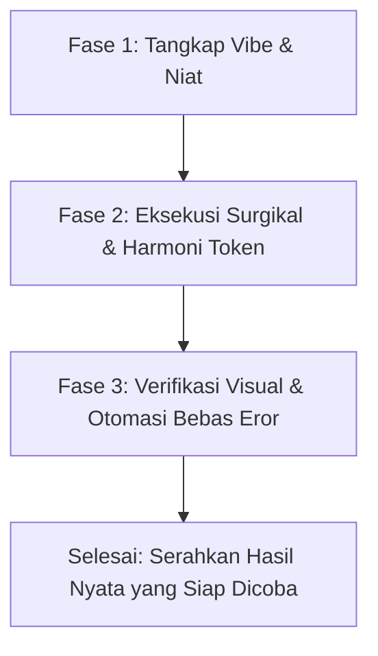

# SKILL: Vibe Coding Guardrails & Defensive Engineering

Panduan ini mendefinisikan sistem pagar pembatas (*guardrails*) dan metodologi rekayasa defensif untuk alur kerja **Vibe Coding** pada proyek **semenitwasted**.

Konsep ini mengintegrasikan filosofi eksplorasi intuitif **Andrej Karpathy** (*"coding with LLMs at the speed of thought, guiding the vibe and aesthetics"*) dengan prinsip rekayasa defensif **Simon Willison** (*"verifiable, sandboxed, regression-proof AI development"*).

---

## 1. APA ITU VIBE CODING DENGAN PAGAR PEMBATAS?

*Vibe coding* memungkinkan Anda (pengguna) untuk berkreasi secara cepat: cukup deskripsikan nuansa, rasa (*feel*), referensi desain, atau perilaku yang diinginkan tanpa harus pusing memikirkan sintaks kode baris-per-baris.

Namun, agar *vibe coding* tidak berakhir menjadi kode yang rapuh (*fragile*), lambat, atau merusak fitur yang sudah berfungsi sebelumnya, agen AI wajib mematuhi **5 Pagar Pembatas Mutlak (The 5 Golden Guardrails)** di bawah ini.

---

## 2. LIMA PAGAR PEMBATAS MUTLAK (THE 5 GOLDEN GUARDRAILS)

### GUARDRAIL 1: ZERO REGRESSION PRINCIPLE (DILARANG MERUSAK KODE LAMA)
- **Aturan**: Saat menambahkan fitur atau mempercantik tampilan visual baru, agen **DILARANG KERAS** menghapus, mengubah nama variabel, atau mengotak-atik elemen yang sudah stabil tanpa izin eksplisit.
- **Pengecekan Komponen Kritis**:
  - Komponen navigasi global (`[data-site-chrome]`) wajib tetap utuh.
  - Bilah kemajuan baca (`#readingProgressBar`) tidak boleh terganggu.
  - Skema data artikel (`window.BLOG_POSTS` di `blog-data.js`) harus selalu valid.
  - ID semantik utama (seperti `#main-content`, `#globalHeader`) tidak boleh diubah.

### GUARDRAIL 2: VERIFIKASI VISUAL MANDIRI (AUTONOMOUS VERIFICATION LOOP)
- **Aturan**: Agen tidak boleh berasumsi kode langsung berjalan mulus. Setelah melakukan perubahan visual atau logika:
  1. Periksa konsol browser (wajib **0 JavaScript Errors / Warnings**).
  2. Pastikan tata letak tidak mengalami *horizontal scroll leak* atau teks terpotong (*overflow clipping*).
  3. Uji responsivitas pada dua viewport utama: Desktop (lebar) dan Mobile (sempit).

### GUARDRAIL 3: ZERO DEPENDENCY CREEP (PERTAHANKAN KEMURNIAN VANILLA WEB)
- **Aturan**: Repositori `semenitwasted` memiliki keunggulan performa mutlak berkat arsitektur **Vanilla HTML, CSS, dan JS murni**.
- **Larangan Keras**:
  - Dilarang menyuntikkan framework berat (React, Vue, dll.) secara tiba-tiba tanpa persetujuan.
  - Dilarang memasang library CSS CDN raksasa (Tailwind CDN, Bootstrap) yang merusak token warna taktil monokrom.
  - Manfaatkan fitur modern web bawaan: Web APIs asli (`IntersectionObserver`, `ResizeObserver`, CSS `:has()`, CSS `clamp()`, CSS Grid).

### GUARDRAIL 4: PRINSIP ZERO DEAD ENDS & ZERO 404s
- **Aturan**: Setiap tombol, link, kartu katalog, atau switch interaktif yang terlihat di layar **wajib berfungsi nyata**.
- **Solusi untuk Ide Baru / Draf**:
  - Jika pengguna ingin membuat ide kartu baru yang artikelnya belum ditulis, jangan biarkan link menuju ke halaman kosong (404).
  - Hubungkan ke modal taktil *Coming Soon / Feature in Progress* yang konsisten dengan estetika monokrom.

### GUARDRAIL 5: EDIT SURGIKAL (SURGICAL CODE DIFFS)
- **Aturan**: Hindari menulis ulang file raksasa dari baris pertama sampai terakhir jika hanya perlu memperbaiki satu atau dua fungsi.
- Gunakan modifikasi bertarget (*targeted replacement*) agar riwayat Git tetap bersih, terukur, dan mudah dibatalkan (*revert-friendly*) jika "vibe" yang dicoba kurang memuaskan.

---

## 3. SIKLUS ALUR KERJA VIBE CODING (THE 3-PHASE VIBE LOOP)

Setiap permintaan fitur baru melalui *vibe coding* dieksekusi melalui 3 fase terpadu:

### Fase 1: Tangkap Vibe & Niat (*Vibe Capture*)
- Pahami apa yang dimaksud pengguna dari kalimat kasualnya:
  *Contoh*: *"Bikin kartu portofolionya lebih berbobot dan asik pas diklik"* $\rightarrow$ Terjemahkan ke: *menambahkan transisi fisika spring, bayangan kontak yang lebih dalam saat hover, dan active state sink -1px*.
- Identifikasi file mana saja yang menjadi target tanpa menyentuh file lain.

### Fase 2: Eksekusi Surgikal & Harmoni Token (*Token Harmony*)
- Pasang perubahan dengan selalu merujuk pada token desain yang sudah ada:
  - Background terang: `#F0EDF4`
  - Kontras teks & elemen gelap: `#211B28`
  - Aksen bayangan taktil ungu tua: `#450D50`
  - Radius sudut kartu: `10px`
  - Font: *Inter*, *Newsreader*, atau font monokrom yang konsisten.

### Fase 3: Verifikasi Visual & Otomasi Bebas Eror (*Verification Loop*)
- Jalankan pengecekan cepat terhadap file yang diedit.
- Pastikan tidak ada sintaks rusak atau link patah.
- Berikan ringkasan singkat dan langsung arahkan pengguna untuk mencoba hasilnya di browser.

---

## 4. PRE-FLIGHT CHECKLIST UNTUK AGEN SAAT VIBE CODING

Sebelum agen melaporkan "Selesai" kepada pengguna, agen wajib memvalidasi checklist ini dalam hatinya:

- [ ] **Tidak ada kode mati / rusak**: Apakah fitur-fitur halaman yang lama masih bekerja 100% normal?
- [ ] **Desain tetap monokrom taktil**: Apakah warna dan bayangan baru selaras dengan `#F0EDF4`, `#211B28`, dan `#450D50`?
- [ ] **Zero Error di Console**: Tidak ada TypeError atau error JavaScript yang membisu di background.
- [ ] **Mobile Responsive**: Apakah elemen baru tetap rapi dan tidak tumpang tindih di layar HP?
- [ ] **Penjelasan Manusiawi**: Laporkan apa yang berubah secara ringkas, tanpa membanjiri pengguna dengan jargon teknis yang membosankan.
